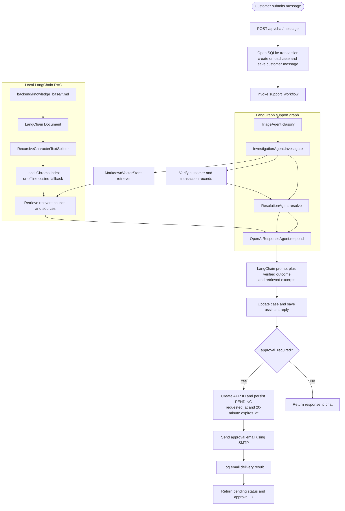
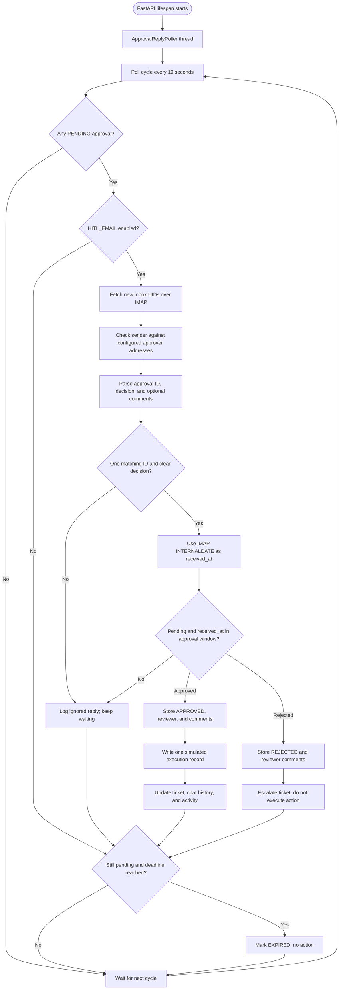

# Saathi developer flow

## Request, LangGraph, and RAG

## Email decision and timeout

### Key implementation points

- The backend worker polls email before expiring approvals. A reply received before `expires_at` can still be applied if IMAP returns it shortly after the deadline.
- Email authorization uses the configured approver address list. The approval ID must match a pending request, and the decision must be explicit.
- `approval_service.apply_channel_decision` stores reviewer comments in `approval_requests`, includes them in the resulting case/chat message, and uses the approval ID as the execution idempotency key.
- Rejections and timeouts never create execution records. Approved actions are simulated in SQLite; no external payment operation is performed.
- The chat and operations UI refresh case state while an approval is pending so the final decision and comments become visible without a manual page reload.
